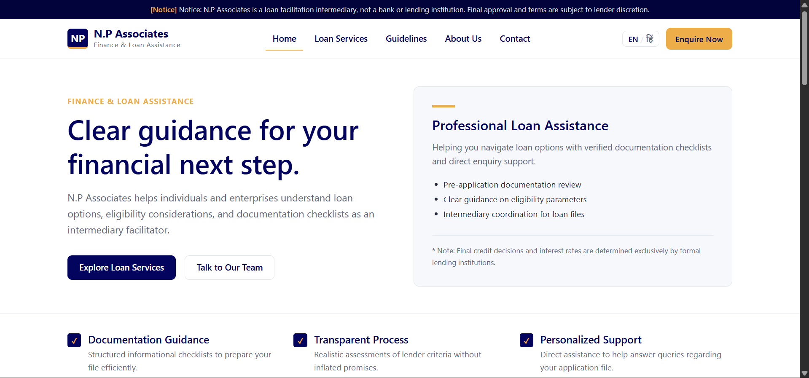
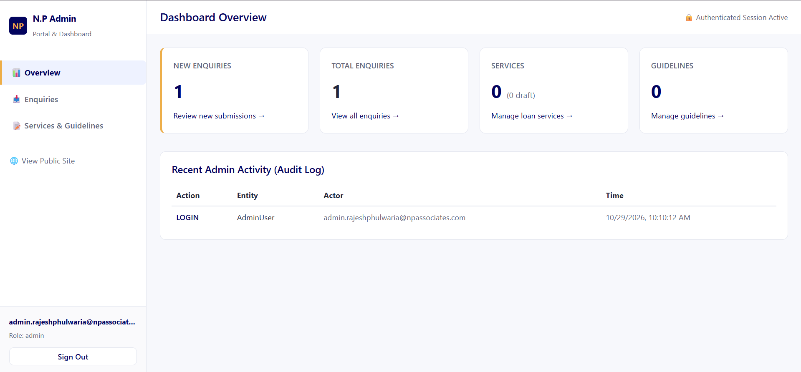

# N.P. Associates — Financial Services Website

A bilingual financial services website with an administrative dashboard for managing services, publishing content, and handling customer enquiries.

**N.P. Associates** aims to make financial and business-related services easier to discover through a clean, accessible website and a centralized content management workflow.

<!-- Replace this with a screenshot of your deployed website -->
<!--  -->

## Table of Contents

- [About the Company](#about-the-company)
- [Project Overview](#project-overview)
- [Features](#features)
- [Tech Stack](#tech-stack)
- [Project Structure](#project-structure)
- [Getting Started](#getting-started)
- [Environment Configuration](#environment-configuration)
- [Running the Application](#running-the-application)
- [Admin Portal](#admin-portal)
- [Available Scripts](#available-scripts)
- [Demo](#demo)
- [Screenshots](#screenshots)
- [Security Notes](#security-notes)
- [Future Improvements](#future-improvements)
- [Author](#author)
- [License](#license)

## About the Company

**N.P. Associates** is the business represented by this website, designed to present its services online and provide customers with a convenient way to explore offerings and submit enquiries.

The website includes a service-management workflow that supports English and Hindi content. Service categories can include home loans and other financial or business services offered by the company.

### Objectives

- Establish a professional online presence.
- Make service information accessible in English and Hindi.
- Help prospective customers discover relevant services.
- Provide a centralized interface for managing services and website content.
- Organize customer enquiries through an administrative dashboard.

*Company details and service descriptions should be verified with the business before publication.*

## Project Overview

N.P. Associates is a full-stack web application consisting of a public-facing website and a protected admin interface.

The frontend communicates with a backend API, while MongoDB stores application data. Administrative routes are protected by session-based authentication.

### Main Components

**1. Public Website**

Presents company information, available services, and customer enquiry functionality.

**2. Admin Dashboard**

Provides authorized administrators with tools to manage enquiries, services, and website content.

**3. Backend API**

Handles application requests, validation, authentication, database operations, and security middleware.

**4. Database**

Stores application records, including administrator accounts and managed website content.

## Features

### Public Website

- Company and service information pages.
- Bilingual service content in English and Hindi.
- Service categories and URL-friendly slugs.
- Customer enquiry submission.
- Publication-aware service content.
- Responsive website interface.

### Admin Portal

- Administrator login and logout.
- Session-based authentication.
- Protected administrative API routes.
- Dashboard for administrative workflows.
- Enquiry management.
- Service and content management.
- Draft and published content states.
- Service ordering through a sort-order field.

### Backend and Security

- REST API organized under `/api/v1`.
- MongoDB integration through Mongoose.
- Password hashing using bcrypt.
- Session management.
- CSRF protection for applicable state-changing requests.
- Rate limiting for general API, authentication, and enquiry requests.
- Security headers through Helmet.
- Request validation and centralized application configuration.

## Tech Stack

| Layer | Technology |
|---|---|
| Frontend | React |
| Frontend tooling | Vite |
| Routing | React Router |
| Backend | Node.js, Express.js |
| Database | MongoDB |
| Database ODM | Mongoose |
| Authentication | Express sessions |
| Password security | bcrypt |
| Security middleware | Helmet, CSRF protection, rate limiting |
| Configuration validation | Zod |
| Backend testing | Vitest |
| Code quality | ESLint |
| Version control | Git and GitHub |

*This list reflects the project's identified architecture. Check the package manifests for exact installed versions and dependencies.*

## Project Structure

The repository is organized into frontend and backend workspaces.

```text
N.P_associates/
├── client
│   ├── src
│   │   ├── api
│   │   │   └── client.js
│   │   ├── components
│   │   │   ├── AdminLayout.jsx
│   │   │   ├── Button.jsx
│   │   │   ├── EnquiryForm.jsx
│   │   │   ├── FormField.jsx
│   │   │   ├── LanguageSwitcher.jsx
│   │   │   ├── SiteLayout.jsx
│   │   │   └── StatusBadge.jsx
│   │   ├── context
│   │   │   ├── AdminAuthContext.jsx
│   │   │   └── LanguageContext.jsx
│   │   ├── i18n
│   │   │   └── translations.js
│   │   ├── pages
│   │   │   ├── AboutPage.jsx
│   │   │   ├── AdminContentPage.jsx
│   │   │   ├── AdminDashboardPage.jsx
│   │   │   ├── AdminEnquiriesPage.jsx
│   │   │   ├── AdminLoginPage.jsx
│   │   │   ├── ContactPage.jsx
│   │   │   ├── GuidelinesPage.jsx
│   │   │   ├── HomePage.jsx
│   │   │   ├── LegalPage.jsx
│   │   │   ├── ServiceDetailPage.jsx
│   │   │   └── ServicesPage.jsx
│   │   ├── styles
│   │   │   ├── global.css
│   │   │   └── tokens.css
│   │   ├── App.jsx
│   │   └── main.jsx
│   ├── eslint.config.js
│   ├── index.html
│   ├── package.json
│   └── vite.config.js
├── docs
│   └── images
│       ├── admin-dashboard.png
│       └── homepage.png
├── server
│   ├── src
│   │   ├── config
│   │   │   ├── database.js
│   │   │   └── env.js
│   │   ├── middleware
│   │   │   ├── csrf.js
│   │   │   ├── errorHandler.js
│   │   │   ├── rateLimiters.js
│   │   │   ├── requireAdmin.js
│   │   │   └── validate.js
│   │   ├── models
│   │   │   ├── AdminUser.js
│   │   │   ├── AuditLog.js
│   │   │   ├── Enquiry.js
│   │   │   ├── Guideline.js
│   │   │   └── LoanService.js
│   │   ├── routes
│   │   │   ├── admin.routes.js
│   │   │   ├── health.routes.js
│   │   │   └── public.routes.js
│   │   ├── services
│   │   │   ├── audit.service.js
│   │   │   ├── content.service.js
│   │   │   ├── enquiry.service.js
│   │   │   └── sampleData.js
│   │   ├── validation
│   │   │   └── schemas.js
│   │   ├── app.js
│   │   ├── bootstrapAdmin.js
│   │   └── server.js
│   ├── test
│   │   ├── admin.auth.test.js
│   │   ├── health.routes.test.js
│   │   └── public.routes.test.js
│   ├── eslint.config.js
│   └── package.json
├── .env.example
├── .gitignore
├── README.md
├── package-lock.json
└── package.json
```

The exact file structure may evolve as the application develops.

## Getting Started

Follow these instructions to run the project locally.

### Prerequisites

Install the following:

- [Node.js](https://nodejs.org/) — use a version supported by the project's `package.json`.
- npm, included with Node.js.
- [MongoDB](https://www.mongodb.com/) — a local installation or a MongoDB Atlas connection.
- Git.

### 1. Clone the repository

```bash
git clone https://github.com/RajeshPhulwaria006/N.P_associates.git
cd N.P_associates
```

### 2. Install dependencies

Run this command from the repository root:

```bash
npm install
```

If the repository has a committed `package-lock.json` and you want a reproducible installation, you can use `npm ci` instead.

### 3. Configure environment variables

Copy `.env.example` to `.env` in the location expected by the backend configuration.

For PowerShell:

```powershell
Copy-Item .env.example .env
```

For macOS/Linux:

```bash
cp .env.example .env
```

Update the database connection, session secret, and other required settings before running the application.

### 4. Start MongoDB

Ensure MongoDB is running locally, or configure your MongoDB Atlas connection string.

For a local database, the example connection string is:

```env
MONGODB_URI=mongodb://localhost:27017/np_associates
```

### 5. Create an administrator account

Set your own bootstrap credentials in the environment, using a strong, unique password.

PowerShell:

```powershell
$env:ADMIN_BOOTSTRAP_EMAIL="your-admin@example.com"
$env:ADMIN_BOOTSTRAP_PASSWORD="YourStrongPasswordHere"
node server/src/bootstrapAdmin.js
```

Run this against the intended database. Do not commit real credentials to Git.

### 6. Start the application

From the repository root:

```bash
npm run dev
```

The frontend development server is configured for port `3000`, and the backend defaults to port `5000`.

Open the local website at:

- **Website:** http://localhost:3000
- **Admin login:** http://localhost:3000/admin/login

These are local development URLs, not public production URLs.

## Environment Configuration

Refer to `.env.example` for the exact environment variables supported by the project.

Common settings include:

| Variable | Purpose |
|---|---|
| `MONGODB_URI` | MongoDB connection string |
| `SESSION_SECRET` | Secret used to sign session identifiers |
| `CLIENT_ORIGIN` | Allowed frontend origin for CORS |
| `PORT` | Backend listening port |
| `ADMIN_BOOTSTRAP_EMAIL` | Email used to create the initial administrator |
| `ADMIN_BOOTSTRAP_PASSWORD` | Password used to create the initial administrator |

Some variables are used by the bootstrap script rather than the long-running application. Confirm their loading behavior in the corresponding source files.

### Important

- Replace every development placeholder before deployment.
- Use a strong, randomly generated session secret.
- Keep `.env` out of version control.
- Never expose database credentials or administrator passwords in frontend code.
- Use separate configuration and databases for development and production.
- Follow `.env.example` and the backend Zod schema when adding new settings.

## Running the Application

### Development mode

```bash
npm run dev
```

Starts the project's development workflow as defined by the root package scripts.

### Build the frontend

```bash
npm run build
```

Creates the production frontend build.

### Run lint checks

```bash
npm run lint
```

Checks the project using its configured linting scripts.

### Run tests

```bash
npm test
```

Runs the test suite configured in the repository.

A successful local build alone does not guarantee that production authentication, database access, or deployment routing is configured correctly.

## Admin Portal

The administrative interface is available at:

```text
/admin/login
/admin/dashboard
/admin/enquiries
/admin/content
```

These routes are intended for authorized administrators.

### Typical workflow

1. Create the initial administrator using the bootstrap script.
2. Open the admin login page.
3. Sign in with the credentials configured for your environment.
4. Review enquiries and manage website content.
5. Create or update services using the service management form.
6. Save content as a draft while reviewing it.
7. Publish content when it is ready for the public website.

### Service management

A service record can include:

- **Slug:** A unique URL identifier, such as `home-loan`.
- **Category:** The service category, such as Home Loan.
- **English title and descriptions.**
- **Hindi title and descriptions.**
- **Publication status:** Draft or published.
- **Sort order:** Controls the intended display order.

Keep service slugs unique and avoid publishing unverified financial claims.

## Demo

**Live demo:** to be added soon

## Screenshots

### Homepage


### Admin Dashboard


Until a public deployment is configured, run the application locally using the instructions above.

## Security Notes

This application handles administrative access and customer enquiries, so security should be verified before public deployment.

- Use HTTPS in production.
- Configure secure session cookies and a persistent production session store.
- Set the exact allowed frontend origin.
- Verify authentication and authorization on every protected backend route.
- Ensure CSRF protection works with production cookies and API routing.
- Keep dependencies updated and review vulnerabilities.
- Validate and sanitize user-controlled input.
- Protect production secrets using the hosting provider's secret management.
- Restrict database access and maintain backups.
- Test backup restoration and document a recovery procedure.
- Never use a development session secret or the in-memory session store for production.

## Future Improvements

Potential enhancements include:

- Automated end-to-end tests for public and admin workflows.
- Continuous integration with GitHub Actions.
- A staging environment before production releases.
- Accessibility and responsive-design audits.
- Structured logging, error monitoring, and uptime checks.
- Database backup and restore automation.
- Search engine optimization and metadata improvements.
- A verified live demo and documented deployment process.

These are possible next steps, not claims that every item is already implemented.

## Author

**Rajesh Phulwaria**

- GitHub: [@RajeshPhulwaria006](https://github.com/RajeshPhulwaria006)
- Project repository: [N.P. Associates](https://github.com/RajeshPhulwaria006/N.P_associates)

Built as a full-stack web development project focused on company service presentation, bilingual content, and administrative workflows.

## License

**Copyright © 2026 N.P. Associates. All rights reserved.**

This repository and its contents are provided for viewing purposes only. Unless expressly authorized in writing by the copyright holder, no permission is granted to copy, reproduce, modify, distribute, publish, or commercially use this source code or its associated materials.

All rights not expressly granted are reserved by the copyright holder.

For permission to use this code, please contact the copyright holder.

---

*For setup issues or project feedback, open an issue in the GitHub repository.*
